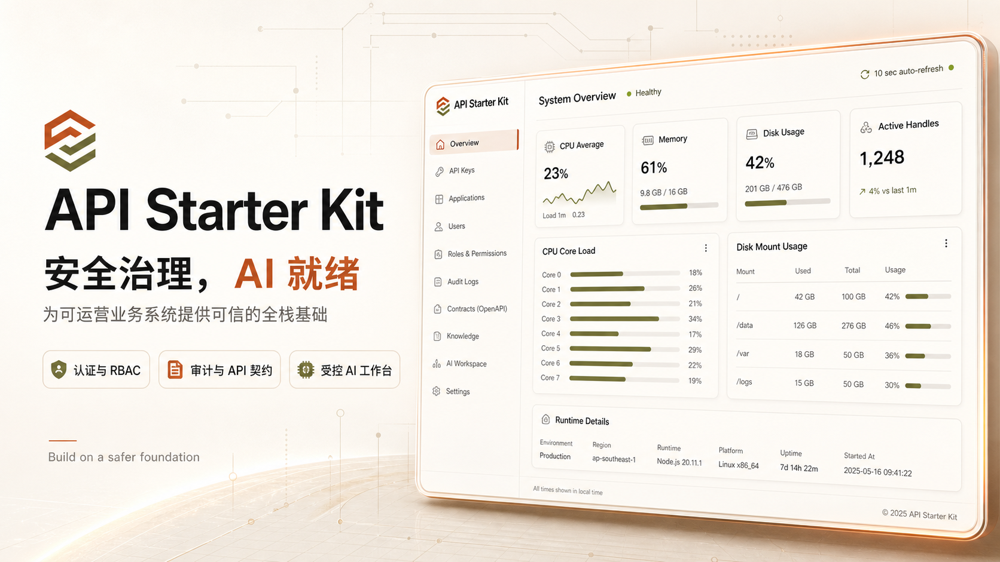

# API Starter Kit

> 面向 AI 管理应用的全栈模板，提供认证、权限、审计、知识检索和受控 AI 等系统能力。

API Starter Kit 是 pnpm/Turborepo monorepo。它提供构建业务应用所需的系统基础，不预设具体业务领域。

| 应用         | 目录                        | 职责                                                |
| ------------ | --------------------------- | --------------------------------------------------- |
| Backend      | `apps/backend`              | API、认证授权、数据、审计、AI runtime 和渠道 worker |
| 管理端 Web   | `apps/frontend`             | 系统管理页面与内置 AI 助手                          |
| 独立助手 Web | `apps/assistant-web`        | 全屏 AI 助手客户端                                  |
| 桌面端       | `apps/assistant-desktop`    | 使用 Tauri 打包独立助手 Web                         |
| Chrome 扩展  | `apps/assistant-extension`  | 独立助手的 MV3 side panel                           |
| 身份验证器   | `apps/authenticator-mobile` | 移动端 TOTP 账户管理                                |

管理端、独立助手客户端和企业微信、飞书、钉钉机器人共享后端能力。桌面端与 Chrome 扩展复用独立助手客户端；业务系统由使用者按产品需求扩展。

## 开始使用

- [快速开始](docs/getting-started.md)：配置本地环境并启动基础服务。
- [文档总览](docs/README.md)：按开发、部署和专题查找文档。
- [交互式项目图表](https://ospoon.github.io/api-starter-kit/)：浏览架构、代码组织和主要工作流。

## 开发与扩展

- [工程开发指南](docs/development.md)：工作区命令和各应用验证方式。
- [产品扩展指南](docs/customization.md)：从产品需求新增业务能力。
- [系统架构](docs/architecture.md)：应用职责和请求边界。

## 许可证

[MIT](LICENSE)
