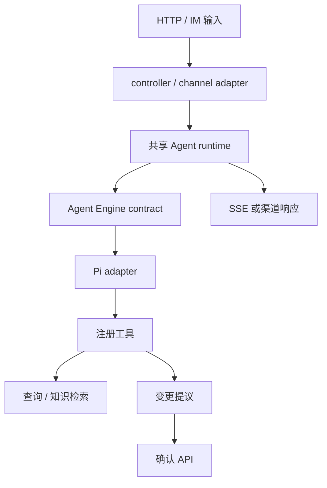

# AI 助手架构

本文描述 backend AI runtime 的主要边界和数据流。用户可用能力见[AI 助手能力](ai-assistant-capabilities.md)；提示词与工具描述的源码位置见下文。具体 API schema 以 OpenAPI 为准。

## 运行时分层



- `apps/backend/app/ai/agent` 定义 Agent、Tool、Event 和 Session 契约，并提供当前 Pi adapter。
- Backend 管理会话编排、提示策略、授权、审计、工具注册和持久化；可复用的领域逻辑位于 `apps/backend/app/services`。
- HTTP controller 处理会话归属、输入校验、消息持久化和 SSE 生命周期。渠道 adapter 将平台消息转换为共享 Agent 输入，不另建 AI runtime。
- `ai_agent_runtime` 组合模型配置与 backend 工具；替换 Agent adapter 不应复制授权、审计或领域 service。
- 内置工具、查询、操作和技能通过现有 registry 接入；技能内容是非可信输入，不能定义权限或替代工具契约。
- MCP 支持管理员配置的 stdio 子进程和 Streamable HTTP。stdio 进程以 backend 用户身份运行且不经过技能 sandbox；HTTP 请求由 backend 发起。只配置可信程序和服务地址。工具声明 `readOnlyHint: true` 时直接执行，其他调用需用户确认。当前使用项目自有 registry，不加载通用 Pi 插件。

## 提示词与工具描述的维护入口

| 内容                             | 源码位置                                                                                                                                  |
| -------------------------------- | ----------------------------------------------------------------------------------------------------------------------------------------- |
| Agent 系统、领域、渠道与摘要提示 | `apps/backend/app/ai/policy/ai_agent_prompt_policy.ts`                                                                                    |
| 工具描述与参数 schema            | `apps/backend/app/ai/registry/ai_agent_tool_registry.ts`、`apps/backend/app/ai/tools/`、`apps/backend/app/ai/agent/pi/tool_parameters.ts` |
| 查询模板契约                     | `apps/backend/app/ai/registry/ai_agent_query_registry.ts`、`apps/backend/app/ai/queries/`                                                 |
| 操作与确认续答                   | `apps/backend/app/ai/core/ai_agent_action_registry.ts`、`apps/backend/app/ai/chat/confirmed_tool_result_summary.ts`                       |
| 知识元数据提示                   | `apps/backend/app/services/knowledge_metadata_service.ts`                                                                                 |
| 界面文案与行为评估               | `apps/frontend/src/locales/`、`apps/backend/app/ai/evaluation/`、`apps/backend/tests/`                                                    |

行为规则变更同步更新 backend 测试或评估用例；用户可见文案以 locale 源文件为准。工具、查询、操作和确认契约见 [`apps/backend/AGENTS.md`](../apps/backend/AGENTS.md)。

## 查询与操作边界

查询只调用 `ai_agent_query_registry` 中的固定模板。模板定义参数、权限、服务端范围、最小 DTO 和结果上限；缺参状态会保存并在续问时重新验证。模型请求在共享 Pi provider 边界统一脱敏：识别结构化敏感字段及邮箱、电话、IP、卡号和常见凭据格式；不等同完整 DLP，无法识别未标注姓名或图片内容。可逆映射仅缓存在 backend 进程内，闲置 24 小时清理，最多 256 个会话；凭据替换为不可逆的 `[REDACTED]`。重启、切换副本或缓存驱逐后，映射不保留。

有副作用的管理操作只创建持久化提议。确认 API 在执行前复核会话归属、权限、提议状态和目标当前状态，并记录审计。模型生成的文本不参与授权判断。完整规范见 [`apps/backend/AGENTS.md`](../apps/backend/AGENTS.md) 的 AI 章节。

知识检索按目录与正文两阶段执行；正文检索只能使用本轮目录结果中的文档。字段、角色范围、审计和维护方式见[知识库实现说明](knowledge-base.md)。

管理员可从可信 Git 来源或单技能 ZIP 安装技能，新技能默认停用。启用后，Agent 可读取技能说明和资源；脚本由 backend 子进程在 OS sandbox 中运行，限制文件、网络、时长和输出。Node 脚本另受 Node Permission Model 限制。Linux 部署需允许 bubblewrap 建立所需 namespace；详细条件见[部署指南](deployment.md)。

## 会话与持久化

- `AiChatConversation` 和 `AiChatMessage` 保存完整历史；敏感信息只在发往模型的请求上下文中替换，脱敏映射不写入数据库。
- 模型上下文压缩只影响请求上下文；滚动摘要持久化在会话上，不能截断历史记录。
- Agent 私有快照用于恢复工具调用上下文；思考内容与图片二进制不进入该快照。
- 图片数据与消息关联保存在 PostgreSQL；历史接口只提供必要元数据，授权后的图片接口才返回原始内容。
- Pending query 保存缺参状态，不保存查询结果；confirmation 保存待确认提议，不向普通消息暴露敏感 payload。
- 一个回复可关联多个确认项；所有确认或取消决策完成后，Agent 才根据已保存结果生成汇总。

客户端中止、用户停止或请求超时会终止当前运行；已持久化消息保留，后续用户消息创建新的 Agent 运行。对话状态清理由共享状态服务负责。

## SSE 与客户端

Backend 将 Agent 事件转换为 SSE，包括阶段、计划、工具状态、确认、文本增量、完成和错误。运行详情按事件写入消息并由历史接口恢复。详情保留已结束的准备与模型阶段，同一工具调用按调用 ID 更新一条记录。即使回复未调用工具，也可查看运行汇总。失败的运行保留当时的耗时和已记录用量。只有工具主动提供白名单进度时才展示其内部进度。

共享 AI UI、API、认证与 locale 位于 `apps/frontend`。各入口职责如下：

| 客户端                | 负责内容                                      |
| --------------------- | --------------------------------------------- |
| 管理端                | 系统管理页面和浮动助手                        |
| `assistant-web`       | 复用共享助手组件的独立 Web 路由与页面壳       |
| 网站嵌入              | `assistant-web` 托管浮动助手 iframe 与 loader |
| `assistant-desktop`   | 打包 assistant-web 的 Tauri 原生窗口          |
| `assistant-extension` | 将 assistant-web 装入 Chrome MV3 side panel   |

## 开发遥测

Pi telemetry 仅在 `NODE_ENV=development` 时启用。配置 `LANGFUSE_BASE_URL`、`LANGFUSE_PUBLIC_KEY` 和 `LANGFUSE_SECRET_KEY` 后，trace 会导出到 Langfuse；缺少配置时不向外部发送。Agent trace 记录模型、用量、成本、停止原因和工具标识，不附加原始提示词、回复、工具参数或查询结果。

变量示例见 backend [`.env.example`](../apps/backend/.env.example)。

## 验证

修改 Agent、查询或确认流程时，可运行 backend 全量测试和模型行为评估：

```bash
pnpm test:agent-workflows
pnpm --dir apps/backend exec node ace ai:evaluate
```
