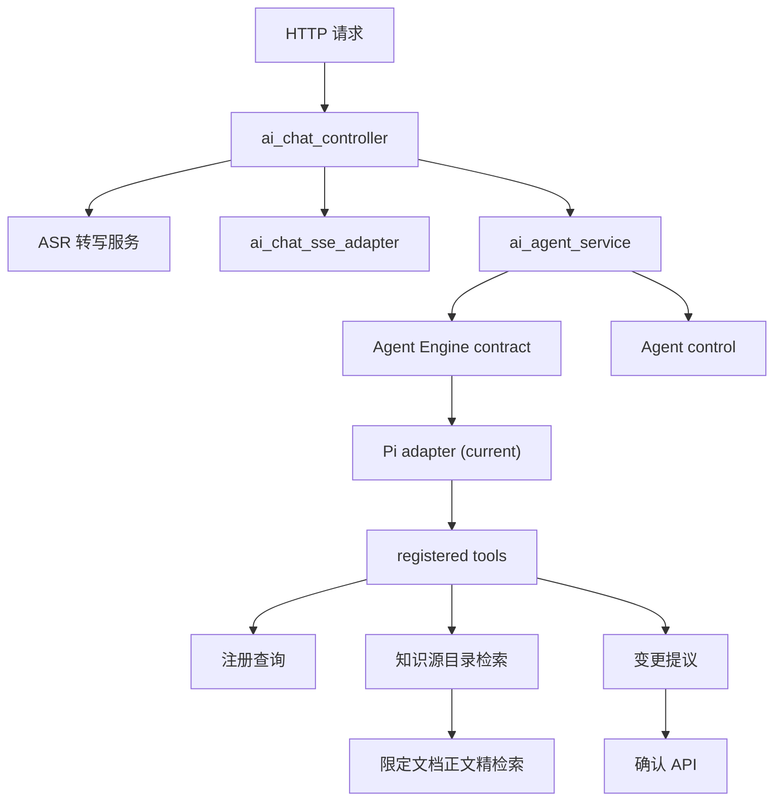

# AI 助手架构

本文档描述当前 AI 助手的实现边界、数据流和维护入口。产品能力说明见 [AI 助手能力](ai-assistant-capabilities.md)。

## 运行时分层



- `apps/backend/app/ai/agent` 定义 Agent/Tool/Event/Session 契约并实现当前 Pi adapter。backend 在同一应用内维护会话编排、提示词策略、授权、审计、工具注册与持久化；可复用的领域逻辑仍位于 `apps/backend/app/services`。
- `AiChannelBridge` 将各 IM Bot 解析后的单张图片和文字保存为同一条 `AiChatMessage`，并调用现有 Agent turn；平台适配器负责下载或解密，不创建独立视觉模型流程。
- `ai_chat_controller.ts` 只负责会话归属、输入校验、消息持久化和 HTTP/SSE 生命周期。
- `ai_chat_controller.ts` 的 `transcribe` 处理管理端 Web、独立助手 Web 和桌面 WebView 的 multipart 音频上传；`ai_speech_service.ts` 使用运行时 LLM 配置调用 OpenAI-compatible ASR 服务，并只返回转写文本。转写接口不直接创建聊天消息，客户端拿到文本后复用普通消息 SSE 链路。
- `ai_chat_sse_adapter.ts` 消费通用 `AgentEvent` 并转换为 SSE、keepalive、工具状态详情、阶段和确认事件。助手文本按单次模型响应暂存；响应包含工具调用时丢弃其中的说明文字，纯文本响应结束后再发送，工具进度仍实时发送。
- `ai_agent_service.ts` 负责 backend 的运行记录、用量和遥测；`ai_agent_runtime.ts` 是 Agent 组合点，加载模型配置、构造 backend 工具并选择 `#ai/agent/pi`。替换 Agent 时只需替换这个 adapter 选择，授权、审计和领域工具留在 backend。
- `ai_agent_tool_registry.ts` 返回核心包定义的 `AgentTool[]`；工具 schema、执行逻辑和业务服务调用仍由 backend 维护。
- `ai_agent_skill_service.ts` 通过固定版本的 Vercel `skills` CLI 安装和移除技能，工作目录由 `AI_AGENT_SKILLS_DIR` 指定，默认使用 `apps/backend/storage`，技能文件位于其 `.agents/skills/` 下。助手配置页是管理入口；新技能默认停用，启用状态是技能运行的唯一管理开关。`list_agent_skills` 和 `load_agent_skill` 只暴露启用技能的说明和受限资源读取。`bash` 只接受启用技能目录内的 JavaScript 文件，并在助手服务进程所在环境直接执行。
- Pi adapter 使用 Pi hooks 完成请求前的上下文刷新、上下文压缩、轮次结束判断及工具调用前后处理；业务侧策略由 backend 回调提供。
- 上下文按 token 预算压缩，摘要写入 `AiChatConversation.contextSummary`，完整消息历史不变；终态工具结果不会触发无意义的下一轮推理。
- 工具进度经核心事件契约归一化后，仅白名单字段转发到 `agent_status` SSE 事件。
- Pi 使用并行调度器，并由各工具声明执行模式：权限诊断和注册查询可并行；任务计划更新、知识目录到正文的依赖检索、变更提议和需要确认的内置工具保持串行。注册查询会维护待补参数状态；正文精检索只能使用本轮目录返回的文档 ID。

## 工具边界

| 工具                                     | 行为                                                                                                                                                                           |
| ---------------------------------------- | ------------------------------------------------------------------------------------------------------------------------------------------------------------------------------ |
| `diagnose_my_access`                     | 只诊断当前认证用户的服务端权限。                                                                                                                                               |
| `run_registered_query`                   | 只调用 `ai_agent_query_registry` 中的固定模板；禁止自由 SQL。所有列表固定最多返回 20 条，不提供分页或继续查询协议，更多数据需到对应管理模块查看。                              |
| `search_knowledge_catalog`               | 两阶段检索第一步。按当前角色或公开范围检索知识源目录，最多返回 12 个候选文档的标题、说明和主题，不返回正文片段。                                                               |
| `search_knowledge`                       | 两阶段检索第二步。必须限定在本轮目录返回的 1 至 10 个文档 ID 内检索正文分块；返回的摘录才是回答知识库事实的证据。                                                              |
| `update_task_plan`                       | 仅为复杂多步请求发布或更新最多 8 步的进度计划；计划只用于展示，不代表业务操作已完成。                                                                                          |
| `list_agent_skills` / `load_agent_skill` | 枚举已启用技能并读取 `SKILL.md` 或技能目录内的小型资源文件；技能内容是非可信工作流说明，只能配合已注册工具使用。                                                               |
| `bash`                                   | 只执行已启用技能声明的 Node 脚本；Node 权限模式限制文件读取范围并默认阻止子进程、Worker 等能力，同时对常见高危 API 做静态拦截。已声明的 `system-status` 能力提供服务状态快照。 |
| `propose_system_management_change`       | 只创建非 API Key 的持久化变更提议（如用户、角色、权限），不执行破坏性操作。执行必须经过确认 API。                                                                              |
| `propose_api_key_creation`               | 只创建 API Key 的持久化变更提议；不执行，必须经过确认 API。                                                                                                                    |
| `propose_api_key_revocation`             | 只创建吊销活跃 API Key 的持久化提议，与删除工具解耦；不执行。执行必须经过确认 API。                                                                                            |
| `propose_api_key_deletion`               | 只创建删除已吊销 API Key 的持久化提议；不执行。执行必须经过确认 API。                                                                                                          |

查询模板具有稳定 code/version、参数 schema、权限码、服务端作用域、字段脱敏和固定 20 条结果上限。缺少必要参数时，`AiAgentPendingQuery` 只保存参数收集状态，下一轮会话重新校验模板、归属、权限和有效期。

知识库的管理字段、LLM 元数据预览、文件限制、角色范围、两阶段检索和审计事件见[知识库实现说明](knowledge-base.md)。目录元数据仅用于选源，模型必须使用第二阶段返回的正文摘录回答，不得把目录摘要或通用模型知识当作证据。

变更提议由 `prepare` 创建安全目标摘要和 payload；`confirmAiAgentAction` 在执行前重新校验会话归属、权限、proposal 状态、有效期和目标当前状态，并记录审计。

技能通过 `skills` CLI 安装到应用专属持久目录；Docker Compose 使用 `assistant-skills` 命名卷保存目录和 CLI lock 文件。可在助手配置的“技能”分区输入 GitHub 简称、GitHub 仓库 URL 或 Git remote URL。安装阶段不会运行技能文件；新技能默认停用，管理员启用后，模型可按技能说明中的 Node 命令调用内置 `bash` 工具。技能启用状态是唯一运行开关，不另设用户运行权限。

启用技能的脚本直接运行在后端服务所在的宿主机或容器中。执行器使用 Node 权限模式，只开放技能目录的文件读取，不开放文件写入、子进程、Worker、原生扩展和 Inspector；还会对技能目录内的 JavaScript 源码检查常见网络、进程、动态代码和文件写入 API，并限制为 30 秒、256 MiB V8 堆和 64 KiB 输出。此模式是降低误用风险的限制，不是安全沙箱；Node 权限模式和静态检查都不能保证抵御恶意脚本，技能安装和启用必须只针对可信来源。容器部署时，系统信息脚本看到容器环境；开发模式看到本机 macOS 环境。服务状态快照仍由现有 `system_status_service` 提供，可作为 `runtimeContext["system-status"]` 返回给模型，并通过 `ASSISTANT_SKILL_CONTEXT_JSON` 注入脚本环境。

技能可在 frontmatter 中声明受支持的 `assistant-capabilities`。当前只支持 `system-status`；能力快照由已启用技能的声明决定，不另设运行权限。快照包含服务 CPU、内存、磁盘和运行时信息；能力名由服务器白名单控制，技能声明不能增加白名单之外的能力。

## 状态与持久化

- `AiChatConversation`、`AiChatMessage`：保存完整用户可见历史、引用和脱敏后的 `runtime_details`；后端私有的 `agent_context` 保存带 `engineId` 和 `version` 的会话快照，用于恢复工具调用上下文。旧 Pi 消息数组仍可读取；快照排除思考内容并脱敏敏感字段，确认工具的结果或取消状态按原 tool-call ID 写回，单条结果最多保存 20,000 字符。
- 图片消息将图片二进制保存在 PostgreSQL `ai_chat_messages.image_data`，MIME 类型保存在 `image_mime_type`；每条消息一张 JPEG、PNG 或 WebP，最大 2 MB。历史 API 只返回 MIME 元数据并在查询时跳过图片字节；受会话归属校验的图片读取 API 才返回原始图片。Agent 会把图片加入视觉模型请求；会话快照剔除图片数据，后续请求按源消息 ID 从数据库重新加载，遥测也不记录图片内容。
- 首条图片消息会额外调用一次无工具的视觉模型，根据图片、用户文字和页面标题总结会话标题；调用用量单独记录，且不启用模型遥测。标题生成失败不会阻断实际 Agent 请求，会回退到用户文字或页面标题。
- 每次新请求根据 `AiChatMessage` 构造初始上下文；运行中的人工介入使用 Agent control 的 `steer` 或 `followUp` 队列，不重新构造 Agent。
- 当前 Pi adapter 按模型 `contextWindow` 和输出预算进行 token 级上下文处理；数据库仍保存完整历史，滚动摘要存储在会话上并在下一次请求注入动态上下文。
- `AiAgentPendingQuery`：保存多轮查询的缺参状态，不保存原始查询结果。
- `AiAgentConfirmation`：保存待确认提议及安全摘要，不向普通消息暴露 payload 或密钥。
- 同一助手消息关联多个工具确认时，逐项处理确认或取消；只要还有待处理项，就暂缓模型结论。全部决策完成后再基于已保存的工具结果生成一次汇总，已取消的操作不会再次执行。
- `ai_conversation_state.ts`：统一清理 pending query；重新生成和会话删除通过此入口处理。

客户端断开、用户停止生成或请求超时会调用 Agent control 的 `abort`；系统保留已持久化消息，下一次用户消息会创建新的 Agent 运行。运行中的人工输入使用 `steer` 或 `followUp`，受控管理操作仍必须经过结构化确认。

AI 请求的审计与运行状态由现有审计日志和运行状态记录；模型调用链路的开发遥测见下文。知识库目录和正文检索分别记录 `knowledge.catalog_searched` 与 `knowledge.searched`，只保存查询哈希、授权结果、数量和耗时，不保存原始查询或正文摘录。

### AI 遥测与 Langfuse

- `pi-telemetry` 仅在 `NODE_ENV=development` 时启用，开发环境默认采集，不需要额外的启用开关。非开发环境使用 no-op telemetry context。
- 配置 `LANGFUSE_BASE_URL`、`LANGFUSE_PUBLIC_KEY` 和 `LANGFUSE_SECRET_KEY` 后，后端会通过 OpenTelemetry OTLP exporter 将已完成的 trace 发送到 Langfuse。缺少任一配置时仍会在开发进程内采集，但不会向外部平台发送。
- Trace 包含 Agent 运行、模型调用和工具调用层级；记录模型请求输入与输出、工具参数与结果，以及模型名称、token 用量、缓存用量、成本、耗时和错误状态。会话 ID 对应 AI 会话 ID。请在 Langfuse 中通过 `AI agent run` trace 查看完整调用树。
- 导出时跳过 Pi 框架的 `pi.ai.request` 和 `pi.ai.poll` span，保留应用层 `api-starter.ai.model_call` 模型调用记录，避免同一次模型调用在 Langfuse 中重复显示。
- 开发遥测内容来自真实模型上下文和工具执行数据；配置 Langfuse 导出前，应将开发环境连接到适合接收这些数据的项目。三个变量的格式和示例见后端 [`.env.example`](../apps/backend/.env.example)。

## SSE 与前端

后端通过 SSE 发送用户消息、Agent 阶段与计划、工具状态、确认、引用、文本增量、运行摘要、完成和错误事件。新对话与确认执行使用各自的流式接口；确认执行会按待确认记录关联的 `assistantMessageId` 更新原助手消息，因此确认前后的模型轮次和工具记录仍显示在同一条回复下。

`agent_phase`、`agent_plan` 和 `agent_status` 会在事件到达时同步写入助手消息的 `runtime_details`，并通过同一 `callId` 更新进行中记录；页面刷新后从消息历史恢复已持久化详情。模型请求和工具调用按事件顺序显示，界面不显示轮次编号；任务计划与确认计划使用不同类型，避免相互覆盖。受控工具的目标定位、准备和确认阶段合并到对应工具行，避免同一次工具调用散落在多处。

运行详情展示工具名称、状态、阶段和经过脱敏及长度限制的文本摘要，不保存完整工具结果或原始参数。长摘要在界面中单行省略，悬停可查看其受限文本。工具发出 `tool_execution_update` 时，后端只转发白名单进度字段；未提供进度事件的工具只能显示开始、结束及耗时，不能观察其内部步骤。

前端 `ai-chat-api.ts` 解析 SSE，`useAiChat.ts` 管理流式消息、确认状态和转写状态，`AiChatAssistant.vue` 提供会话、工具状态、确认、图片/文字输入、语音录音、实时波形、重试、停止生成和快捷建议。发送图片后，客户端先显示本地预览，服务端确认消息后切换到授权读取的持久图片。运行详情在运行中自动滚动到最新事件，内容区最大高度固定为 `180px`；工具尚未返回时会保留进行中状态与经过时间。该状态证明请求仍在执行，但不代表工具一定提供了更细粒度的内部进度。AI 查询没有“继续查看”按钮；完整数据由业务模块自身的列表分页提供。

## 独立 Web 客户端

`apps/assistant-web` 是 AI 助手的独立 Web 客户端入口。它复用 `apps/frontend` 中的
`AiChatAssistant.vue`、`useAiChat.ts`、AI feature API、认证、locale 和 UI primitives，
因此不会复制或分叉聊天协议、SSE 事件、确认操作、一次性凭据展示、语音转写和用量统计实现。
独立客户端通过 `AiChatAssistant` 的 `page` 模式使用全屏工作区布局；后台应用继续使用默认的
浮动模式。独立客户端的页面外框、侧栏宽度、色彩 token、间距和用户入口状态以管理端
`AppLayout`、`Sidebar`、`SidebarInset` 和 `NavUser` 为唯一视觉基准；会话侧栏底部复用管理平台
用户入口，展示当前用户信息并提供退出登录操作。独立客户端复用根目录和管理端前端约束，
其 `AGENTS.md` 只补充客户端边界，避免复制维护整套通用规则。

客户端自己的路由只保留 AI 会话、登录、2FA、密码过期处理和账户页面；后端仍是认证、
权限、模型调用、持久化和敏感操作的唯一边界。开发时使用 `VITE_DEV_API_PROXY_TARGET`
将 `/api/v1` 代理到后端，生产部署时通过 `VITE_API_URL` 指向 API 服务。它默认监听 `17070`，
与管理端的 `18080` 是两个不同的 Web 客户端入口。

## 独立桌面客户端

`apps/assistant-desktop` 是 Tauri 桌面壳，不复制 Web UI 或 AI 编排。根目录 `pnpm dev` 不会启动桌面端；
需要调试时，先启动 `apps/assistant-web` 的 `17070` 服务，再启动 Tauri 窗口。Tauri 只连接已有的 `17070`，
不会自行启动第二个 Vite 服务。
构建时先构建 Web 客户端，再将
`apps/assistant-web/dist` 作为 Tauri 的前端资源目录。桌面端只负责窗口、Rust 命令、
原生权限和安装包，当前直接复用 Web 客户端现有登录流程，不额外引入桌面端登录态兼容层。
生产 API 域名确定后，还需要收紧
`tauri.conf.json` 的 CSP，并验证桌面 WebView 下的 SSE、麦克风、剪贴板、登录态和历史
路由刷新行为。自动更新暂不启用，必须先确定发布 endpoint、安装包签名和 updater 公钥。

## Chrome 扩展

`apps/assistant-extension` 使用 Extension.js 将同一套 assistant-web Vue 应用装入 Chrome MV3 side panel，
不另建聊天界面、认证状态或 API client。扩展只在用户连接时申请已配置 API origin 的可选 host permission，
不注入页面脚本，也不读取活动标签页内容。扩展构建和发布边界见[扩展 README](../apps/assistant-extension/README.md)。

扩展与独立助手共享的 Vue 组件样式集中在
`apps/frontend/src/assets/assistant-components.css`；构建配置将 `vue-router` 收敛到同一运行时，并对普通
JS/TS 模块启用 AutoImport。修改这些共享模块时遵守根目录 [AGENTS.md](../AGENTS.md) 中的扩展运行时和样式约束。

日常开发、各应用命令和提交前检查统一见[工程开发指南](development.md)。根目录 `pnpm dev` 默认只启动
backend 和管理端；assistant-web、Bot、Tauri 桌面端和 Chrome 扩展按需单独启动。单独启动桌面端时，需先让
`17070` 上的 assistant-web 可访问。

## AI 专项验证

修改 Agent、工具协议、提示词或确认流程后，除[工程开发指南](development.md)中的对应应用检查外，运行：

```bash
pnpm --dir apps/backend exec node ace test --files=tests/functional/ai_agent_query_registry.spec.ts --files=tests/functional/ai_agent_confirmation.spec.ts
pnpm --dir apps/backend exec node ace ai:evaluate
```
