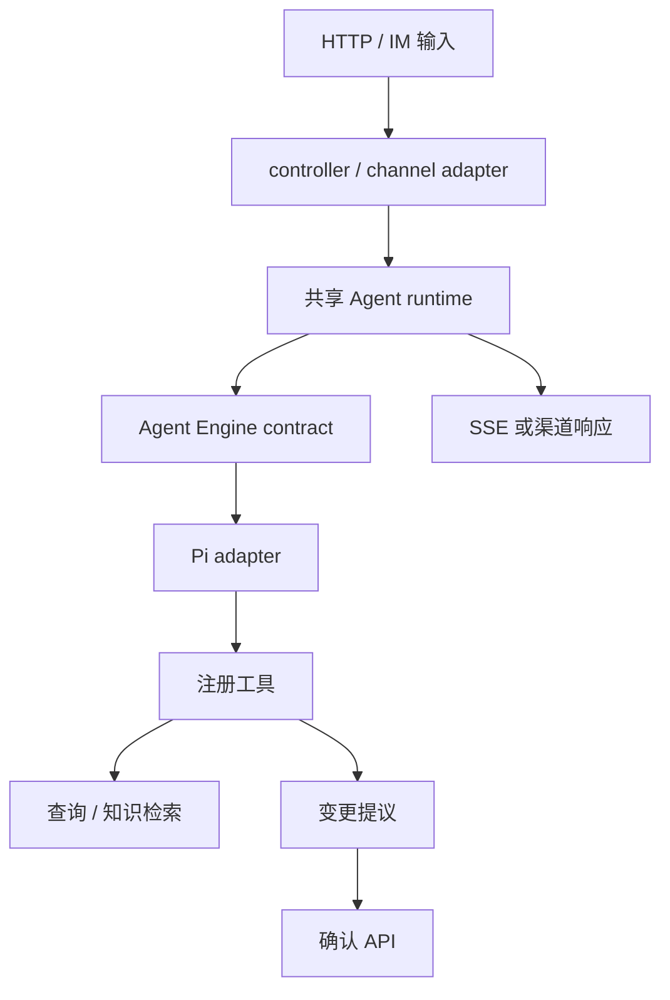

# AI 助手架构

本文描述 backend AI runtime 的主要边界和数据流。用户可用能力见[AI 助手能力](ai-assistant-capabilities.md)；提示词的维护位置见[提示词索引](reference/ai-assistant-prompts.md)。具体 API schema 以 OpenAPI 为准。

## 运行时分层



- `apps/backend/app/ai/agent` 定义 Agent、Tool、Event 和 Session 契约，并提供当前 Pi adapter。
- Backend 管理会话编排、提示策略、授权、审计、工具注册和持久化；可复用的领域逻辑位于 `apps/backend/app/services`。
- HTTP controller 处理会话归属、输入校验、消息持久化和 SSE 生命周期。渠道 adapter 将平台消息转换为共享 Agent 输入，不另建 AI runtime。
- `ai_agent_runtime` 组合模型配置与 backend 工具；替换 Agent adapter 不应复制授权、审计或领域 service。
- Agent 工具和查询分别通过既有 tool、query、action registry 暴露。技能内容是非可信输入，不能定义新的权限或替代注册工具契约。

## 查询与操作边界

查询只调用 `ai_agent_query_registry` 中的固定模板。每个模板定义稳定标识、参数 schema、权限、服务端范围、最小 DTO 和结果上限；缺参时保存待补参数状态，续问时重新验证用户、权限、有效期和模板。所有模型请求在 Pi provider 的共享边界统一脱敏，不在每个查询模板重复维护脱敏字段。结构化字段按通用键名识别个人信息和凭据，文本扫描已识别的邮箱、电话、IPv4、通过 Luhn 校验的卡号和常见凭据格式；结构化 IP 字段也覆盖 IPv6。可逆的个人信息占位符缓存在进程内，并在流式文本和工具调用参数返回 Agent 前还原；后续请求创建 privacy session 时会清理闲置超过 24 小时的映射，缓存上限为 256 个会话。凭据使用不可逆的 `[REDACTED]`，不会恢复。未知的自然语言姓名和图片内容不在扫描范围内；进程重启、切换 backend 副本或映射缓存驱逐后，无法保证从普通历史文本重建这些姓名映射。

有副作用的管理操作只创建持久化提议。确认 API 在执行前复核会话归属、权限、提议状态和目标当前状态，并记录审计。模型生成的文本不参与授权判断。完整规范见 [`apps/backend/AGENTS.md`](../apps/backend/AGENTS.md) 的 AI 章节。

知识检索按目录与正文两阶段执行；正文检索只能使用本轮目录结果中的文档。字段、角色范围、审计和维护方式见[知识库实现说明](knowledge-base.md)。

技能由管理员从可信 Git 来源安装，新技能默认停用。启用后，Agent 可读取其说明和小型资源；仅执行技能目录中的 `.js`、`.mjs`、`.cjs`、`.py`、`.sh` 和 `.bash` 文件，扩展名分别选择 Node.js、Python 3 或 Bash 解释器。脚本由 backend 启动子进程，并通过 OS sandbox 禁用网络、限制写入范围并拒绝访问 backend 应用目录和服务 home 目录，不另建 runner 服务。Node 脚本还使用 Node Permission Model 限制文件 API 的读取范围，并禁用子进程、worker 和 native addons；Node 运行时限制 V8 heap。所有脚本都有执行时间和输出大小限制，执行结束时清理同进程组的子进程。backend 在 Linux 容器中运行时，宿主机必须允许 bubblewrap 建立所需 namespace，否则执行器失败关闭。脚本仍只允许从管理员认可的可信来源安装；该运行时处于 beta 阶段，具体部署条件见[部署指南](deployment.md)。

## 会话与持久化

- `AiChatConversation` 和 `AiChatMessage` 保存完整历史；敏感信息只在发往模型的请求上下文中替换，脱敏映射不写入数据库。
- 模型上下文压缩只影响请求上下文；滚动摘要持久化在会话上，不能截断历史记录。
- Agent 私有快照用于恢复工具调用上下文；思考内容与图片二进制不进入该快照。
- 图片数据与消息关联保存在 PostgreSQL；历史接口只提供必要元数据，授权后的图片接口才返回原始内容。
- Pending query 保存缺参状态，不保存查询结果；confirmation 保存待确认提议，不向普通消息暴露敏感 payload。
- 一个回复可关联多个确认项；所有确认或取消决策完成后，Agent 才根据已保存结果生成汇总。

客户端中止、用户停止或请求超时会终止当前运行；已持久化消息保留，后续用户消息创建新的 Agent 运行。对话状态清理由共享状态服务负责。

## SSE 与客户端

Backend 将 Agent 事件转换为 SSE，包括阶段、计划、工具状态、确认、文本增量、完成和错误。运行详情按事件写入消息并由历史接口恢复；只有工具主动提供白名单进度时才展示其内部进度。

共享 AI UI、API、认证与 locale 位于 `apps/frontend`。各入口职责如下：

| 客户端                | 负责内容                                      |
| --------------------- | --------------------------------------------- |
| 管理端                | 系统管理页面和浮动助手                        |
| `assistant-web`       | 复用共享助手组件的独立 Web 路由与页面壳       |
| 网站嵌入              | `assistant-web` 托管浮动助手 iframe 与 loader |
| `assistant-desktop`   | 打包 assistant-web 的 Tauri 原生窗口          |
| `assistant-extension` | 将 assistant-web 装入 Chrome MV3 side panel   |

扩展共享组件的样式约束见 [`apps/frontend/AGENTS.md`](../apps/frontend/AGENTS.md)；Vue Router provider 与消费者的运行时约束见 [`apps/assistant-extension/AGENTS.md`](../apps/assistant-extension/AGENTS.md)。

## 开发遥测

Pi telemetry 仅在 `NODE_ENV=development` 时启用。配置 `LANGFUSE_BASE_URL`、`LANGFUSE_PUBLIC_KEY` 和 `LANGFUSE_SECRET_KEY` 后，trace 会导出到 Langfuse；缺少配置时不向外部发送。Agent trace 记录模型、用量、成本、停止原因和工具标识，不附加原始提示词、回复、工具参数或查询结果。

变量示例见 backend [`.env.example`](../apps/backend/.env.example)。

## 验证

应用级命令见[工程开发指南](development.md)。修改 Agent、查询或确认流程时，还可运行：

```bash
pnpm test:agent-workflows
pnpm --dir apps/backend exec node ace ai:evaluate
```
