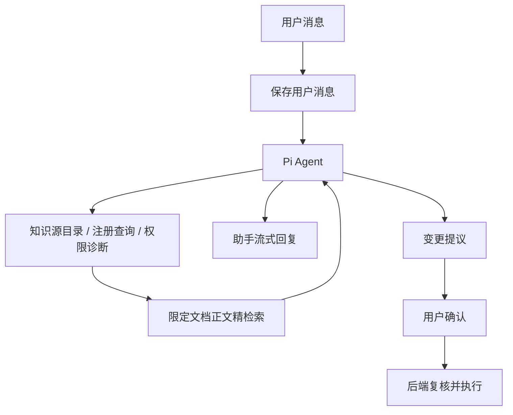

# AI 助手能力

AI 助手是受后端治理、以工具为驱动的管理控制台助手。它根据项目知识、系统查询和权限诊断回答问题，并准备需要确认的管理变更；不会绕过权限、数据库和确认流程。

当前正式支持四种 UI 交付面和三个 IM Bot：管理台 Web、独立助手 Web、Tauri 桌面端、Chrome 扩展，以及企业微信、钉钉、飞书机器人。
它们共用同一套 backend Agent、知识库、注册查询、受控操作、身份绑定和权限校验；桌面端和 Chrome 扩展复用独立助手客户端实现，分别负责原生窗口与浏览器 side panel。
四种 UI 客户端支持通过文件选择或剪贴板发送单张图片，也支持图片加文字提问；企微、钉钉和飞书 Bot 仍按各自渠道表格中的输入形态工作。

## UI 客户端

| 入口           | 目录                       | 定位                                   | 运行关系                                                                                  |
| -------------- | -------------------------- | -------------------------------------- | ----------------------------------------------------------------------------------------- |
| 管理台 Web     | `apps/frontend`            | 系统管理页面和浮动 AI 助手             | 独立管理平台 Web 应用，默认开发端口 `18080`                                               |
| 独立助手 Web   | `apps/assistant-web`       | 全屏会话、历史会话、语音输入和确认操作 | 复用 `apps/frontend` 的 AI 组件、认证、API、locale 和 UI primitives，默认开发端口 `17070` |
| 独立助手桌面端 | `apps/assistant-desktop`   | macOS、Windows、Linux 原生窗口和安装包 | Tauri 只负责窗口、权限和打包；开发时连接 `17070`，发布时内置 assistant-web 静态产物       |
| Chrome 扩展    | `apps/assistant-extension` | Chrome MV3 side panel                  | 复用 `assistant-web` 客户端；连接时按需请求配置的 API origin 权限，不读取当前网页内容     |

独立助手 Web 可以单独作为静态站点部署，生产构建通过 `VITE_API_URL` 连接 backend。桌面端生产构建会先构建
独立助手 Web，再将 `dist` 打进安装包；桌面端运行时不依赖本地 `17070`。开发启动、环境变量和发布边界见
[AI 助手架构](ai-assistant-architecture.md)、[部署指南](deployment.md)和[Chrome 扩展说明](../apps/assistant-extension/README.md)。

## 管理台与渠道能力横向对比

下表比较管理台默认 AI 助手与三个外部渠道。外部机器人通过统一的 `AiChannelBridge` 接入，
与管理台及独立客户端复用同一套 Agent、知识库、注册查询、受控操作、用户绑定和权限校验；完成外部身份绑定后，
各入口的业务能力原则上保持一致，差异主要来自渠道呈现和运行条件。

| 对比维度         | 默认 AI 助手（管理台）                             | 企业微信机器人                                      | 钉钉机器人                                             | 飞书机器人                                                                                |
| ---------------- | -------------------------------------------------- | --------------------------------------------------- | ------------------------------------------------------ | ----------------------------------------------------------------------------------------- |
| 使用位置         | 登录后的管理台 AI 工作台                           | 企业微信智能机器人                                  | 钉钉企业内部应用机器人                                 | 飞书企业自建应用机器人                                                                    |
| 身份与权限       | 直接使用当前登录用户                               | 私聊绑定系统用户；群聊使用隔离的访客主体            | 同左                                                   | 同左                                                                                      |
| 知识库问答       | 支持，显示完整助手回复和工具状态                   | 支持，回复通过企微消息发送                          | 支持，回复通过钉钉消息发送                             | 支持，回复通过飞书消息或卡片发送                                                          |
| 权限诊断         | 支持 `diagnose_my_access`                          | 仅私聊绑定用户                                      | 仅私聊绑定用户                                         | 仅私聊绑定用户                                                                            |
| 实时系统查询     | 支持注册查询模板，结果最多 20 条                   | 仅私聊绑定用户                                      | 仅私聊绑定用户                                         | 仅私聊绑定用户                                                                            |
| 管理变更         | 支持创建 API Key、用户/角色/权限管理等受控操作提案 | 仅私聊绑定用户，确认卡片确认后执行                  | 仅私聊绑定用户，互动卡片确认后执行                     | 仅私聊绑定用户，Interactive Card 确认后执行                                               |
| 普通问答流式体验 | 原生 SSE 增量渲染，可停止、重试并查看工具状态      | 原生企微流式回复                                    | 配置流式回复互动卡片模板后支持；未配置时降级为普通文本 | 不使用 WebSocket 文本流；通过发送并更新 Interactive Card 模拟流式，复杂 Markdown 可能降级 |
| 管理操作确认     | 管理台确认条/确认卡片                              | 企微模板卡片                                        | 钉钉互动卡片模板，需预先发布模板                       | 飞书 Interactive Card                                                                     |
| 对话控制         | 完整历史、创建新会话、继续处理待确认状态           | 支持 `/new` 新建当前渠道会话                        | 支持 `/new` 新建当前渠道会话                           | 支持 `/new` 新建当前渠道会话                                                              |
| 输入形态         | 文本、单张图片、图片加文本、管理台控件             | 文本和企微语音事件                                  | 当前适配文本消息                                       | 当前适配文本消息                                                                          |
| 最适合的场景     | 需要查看上下文、处理较多数据或执行连续管理任务     | 移动端快速问答、语音输入和企微内协作                | 需要钉钉互动卡片和群聊协作                             | 需要飞书卡片化回复和飞书群聊协作                                                          |
| 额外前置条件     | 已登录且拥有对应权限                               | Bot ID、Secret、Tenant ID、WebSocket 配置和身份绑定 | Client ID、Secret，以及按需配置的确认/流式卡片模板     | App ID、Secret、长连接事件订阅、发布版本和消息权限                                        |

### 如何理解这张表

- “支持”表示该入口可以调用同一套后端能力，不表示可以绕过权限。每次查询都会重新校验权限、参数、作用域和结果上限；每次管理变更都必须经过结构化确认。
- 外部机器人不会把自己的平台身份直接当作系统权限。只有完成 `channel + externalTenantId + externalUserId → system user` 绑定后，才可以访问系统能力。
- 群聊访客是例外：不绑定系统账号，只能检索公开知识库；访客会话按群和外部用户隔离，不能访问实时系统数据或发起管理变更。
- 企微、钉钉和飞书的差异不应在业务 service 中分别实现。新增 AI 能力时，应先注册到共享的工具、查询或动作 registry，再由各渠道适配器负责消息和卡片转换。
- 外部渠道更适合快速问答和确认操作；需要完整历史、较长结果、工具过程或连续管理任务时，优先使用管理台或独立助手客户端。查询达到 20 条后，所有入口都应引导用户打开对应管理模块查看完整分页数据。

## 支持范围

UI 助手接受 JPEG、PNG 或 WebP 图片，每条消息最多一张，文件大小不超过 2 MB；图片可以单独发送，也可以和文字一起发送。图片用于帮助 Agent 理解用户任务，任务明确时继续使用现有知识库或注册工具，并遵守原有权限和确认流程；不会默认只描述画面。所选聊天模型必须支持视觉输入。新会话首条图片消息会额外调用一次视觉模型，根据图片、用户文字和页面标题生成会话标题。

| 能力                 | 支持方式                                                                                                                               | 限制                                                                                                                         |
| -------------------- | -------------------------------------------------------------------------------------------------------------------------------------- | ---------------------------------------------------------------------------------------------------------------------------- |
| 项目、产品与流程问答 | `search_knowledge_catalog` → `search_knowledge` 两阶段检索                                                                             | 必须先检索权限过滤后的知识源目录，再限定 1 至 10 个文档检索正文；只使用正文摘录，目录元数据不是回答证据。                    |
| 权限诊断             | `diagnose_my_access`                                                                                                                   | 只针对当前登录用户。                                                                                                         |
| 实时系统查询         | `run_registered_query`                                                                                                                 | 只使用注册模板；固定最多 20 条；不支持自由 SQL、任意字段、分页或继续查询。更多数据请前往 API Key、用户、访问控制或审计模块。 |
| 管理变更             | 专用 Pi `AgentTool` + 确认 API；API Key 创建、吊销、删除分别使用专用工具                                                               | AI 只能生成提案，不能直接执行；确认时再次校验权限和目标状态。不同 API Key 操作彼此独立，避免模型混淆。                       |
| 多轮对话             | Pi Agent、完整消息历史、持久化滚动摘要、工具结果上下文和 pending query                                                                 | compaction 仅影响模型请求，不截断持久化历史；脱敏后的工具结果按 call ID 恢复，确认组全部处理后统一生成结论。                 |
| 复杂任务计划         | 模型通过 `update_task_plan` 发布和更新计划                                                                                             | 只用于展示复杂多步任务进度；计划步骤不能作为工具执行或业务操作成功的证据。                                                   |
| 可扩展技能           | 助手配置页调用 Vercel `skills` CLI 安装 GitHub 或 Git 仓库；助手按需读取已启用技能的说明和资源，并可运行声明 `Bash(node:*)` 的技能脚本 | 新技能默认停用；仅运行技能目录内的 JavaScript 文件，受服务端权限、超时和输出大小限制。                                       |

## 请求流程



查询结果达到 20 条后，助手不会继续请求下一批；应引导用户打开对应管理模块查看完整数据。业务模块自己的表格分页与 AI 助手查询协议相互独立。

管理台和独立助手会在回复下方流式展示可展开的运行详情，按事件顺序显示模型响应、工具状态和必要的执行计划，不显示轮次编号。需要用户确认的工具会先显示等待状态；一条回复有多个确认时逐项处理，在最后一项决策前不生成结论，之后基于保留的工具结果统一续答。长文本在运行详情中单行省略，悬停可查看受限摘要。详情会在固定高度内自动滚动，并在历史消息中保留；没有提供进度事件的工具只显示调用状态和耗时，不展示虚构的内部步骤。

## 安全边界

- 后端是认证、授权、参数校验、脱敏和审计的唯一权威。
- 模型永远不能生成或执行自由 SQL。
- 查询每次调用都重新校验模板、权限和参数，结果固定上限 20 条。
- 知识检索每次先校验 `knowledge:read` 并过滤角色范围；目录最多 12 个候选，正文最多选择 10 个目录结果。第二阶段不能使用其他轮次的文档 ID。
- LLM 元数据提取只返回 `summary`（界面显示为“知识源说明”）和 `topics`（界面显示为“可检索主题”）建议，保存前由管理员审核；旧的来源机构、文档类型、产品或业务对象字段已移除。
- 破坏性操作必须通过结构化确认卡，模型文本不是授权通道。
- 技能由管理员从可信来源安装；安装内容默认停用。已启用技能的说明和资源仍作为不可信输入处理，不能扩大权限或绕过现有工具契约；应用不提供任意 shell 执行。
- API Key、密码、token 和密钥值不会进入普通查询结果、聊天历史或日志。

## 配置与观测

模型、Embedding、ASR 和请求超时通过系统管理中的「LLM 配置」页面维护，保存后对下一次请求生效。Embedding 维度固定为 1024，不支持编辑；所选 Embedding 模型必须返回 1024 维向量。管理台 Web、独立助手 Web 和桌面端均支持语音输入：录音最长 60 秒、音频最大 10 MB，停止后先由配置的 `Qwen3-ASR-0.6B-4bit`（或自定义模型）转写，再将中文文本交给对话模型。上下文预算由模型的 `contextWindow`、输出上限和 Pi 的 token 估算共同控制；长会话由 Pi compaction 生成滚动摘要。

AI 请求运行状态由 Pi Agent、现有审计日志和对话消息记录维护。

评估命令：

```bash
pnpm --dir apps/backend exec node ace ai:evaluate
```

实现细节见 [AI 助手架构](ai-assistant-architecture.md)，知识库细节见 [知识库实现说明](knowledge-base.md)，安全边界见 [安全与治理](security.md)。
