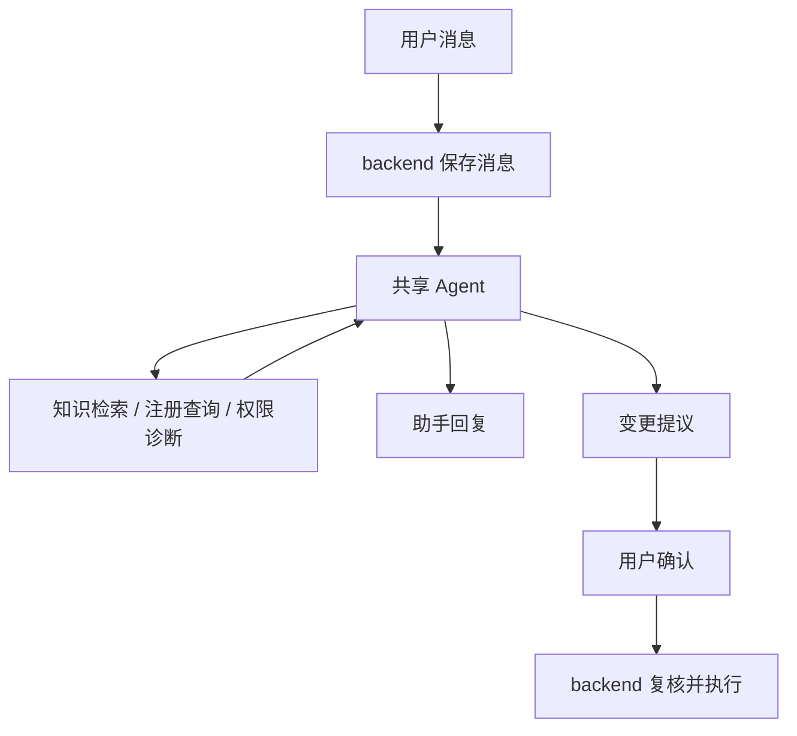

# AI 助手能力

AI 助手通过受控工具使用项目知识和系统数据，并可为管理变更准备待确认提议。认证、权限、数据访问和操作执行始终由 backend 管理。

助手提供四种 UI 入口和三个 IM Bot。它们复用 backend 的 Agent、知识库、查询模板和确认流程；桌面端及 Chrome 扩展复用独立助手客户端。所有入口都支持单张图片和图片加文字提问。

## UI 客户端

| 入口         | 目录                       | 定位                            |
| ------------ | -------------------------- | ------------------------------- |
| 管理端 Web   | `apps/frontend`            | 系统管理页面中的浮动助手        |
| 独立助手 Web | `apps/assistant-web`       | 全屏对话工作区，可单独部署      |
| 桌面端       | `apps/assistant-desktop`   | 使用 Tauri 打包的独立助手客户端 |
| Chrome 扩展  | `apps/assistant-extension` | Chrome MV3 side panel           |
| 网站嵌入     | `apps/assistant-web`       | 通过 script 标签加载浮动助手    |

桌面端和扩展复用独立助手 Web 的界面和客户端逻辑。各入口的本地启动、构建和服务端配置见[工程开发指南](development.md)及[部署指南](deployment.md)。

网站嵌入使用 API Keys 管理页生成的标准 API Key。创建时即可复制 script 标签并粘贴到网站，接入方不需要编写额外客户端代码。同一把 Key 也可用于其他支持的 API 集成；嵌入后 Key 对访客可见，并拥有完整 AI 助手能力。不同浏览器会话的聊天记录彼此隔离，Key 可在管理端吊销。

## 管理台与渠道能力横向对比

企业微信、飞书和钉钉 Bot 通过渠道 adapter 接入共享 Agent。差异主要在身份绑定、消息呈现和平台配置。

| 能力               | 管理台与 UI 客户端             | IM Bot                                     |
| ------------------ | ------------------------------ | ------------------------------------------ |
| 知识问答           | 可用，受用户权限过滤           | 可用；未绑定的群聊访客仅能访问公开知识     |
| 权限诊断与系统查询 | 按当前登录用户权限执行         | 仅对已绑定且有权限的私聊用户开放           |
| 管理变更           | 生成提议，经界面确认后执行     | 生成提议，经渠道确认卡片后执行             |
| 图片提问           | 支持单张图片，可附加文字       | 依渠道接入能力解析图片并调用共享 Agent     |
| 会话管理           | 支持查看历史和继续处理待确认项 | 可通过 `/new` 开始当前渠道的新会话         |
| 消息呈现           | Web 使用流式对话和运行详情     | 使用渠道消息或交互卡片；表现因平台配置而异 |

渠道应用权限、卡片模板、身份绑定和排障见[渠道 Bot 参考](reference/ai-channel-bots.md)。

## 支持范围

- **知识问答：** 先搜索用户可访问的知识源，再检索所选文档正文；回答依据来自正文摘录。
- **权限诊断：** 仅检查当前认证用户的服务端权限。
- **系统查询：** 只运行已注册的查询模板，结果有固定上限；完整列表应在对应管理页面查看。
- **管理操作：** 通过结构化提议与确认流程执行，确认时再次检查权限和目标状态。
- **多轮对话：** 保存完整消息历史；模型上下文可压缩，工具和待补参数状态可跨轮恢复。
- **技能：** 管理员可从可信 Git 来源安装技能。技能默认停用；加载说明时会列出技能目录下的 Node.js、Python 3 和 Bash 脚本相对路径，不要求使用固定的 `scripts/` 子目录。启用后的脚本通过 OS sandbox 限制文件和网络访问，具体边界见[AI 助手架构](ai-assistant-architecture.md)和[部署指南](deployment.md)。
- **多模态：** Web 管理端、独立助手 Web 和桌面端支持语音输入；所有入口支持单张图片。图像模型和 ASR 需在服务端配置。

所有入口均受同一套权限和执行规则约束；Bot 平台身份须先绑定系统用户，群聊访客能力受限。

## 请求流程

## 安全边界

AI 不执行自由 SQL 或任意 shell。数据读取使用注册模板；写操作通过确认 API。工具、查询、提议和权限实现见[AI 助手架构](ai-assistant-architecture.md)，通用安全约定见[安全与治理](security.md)。
